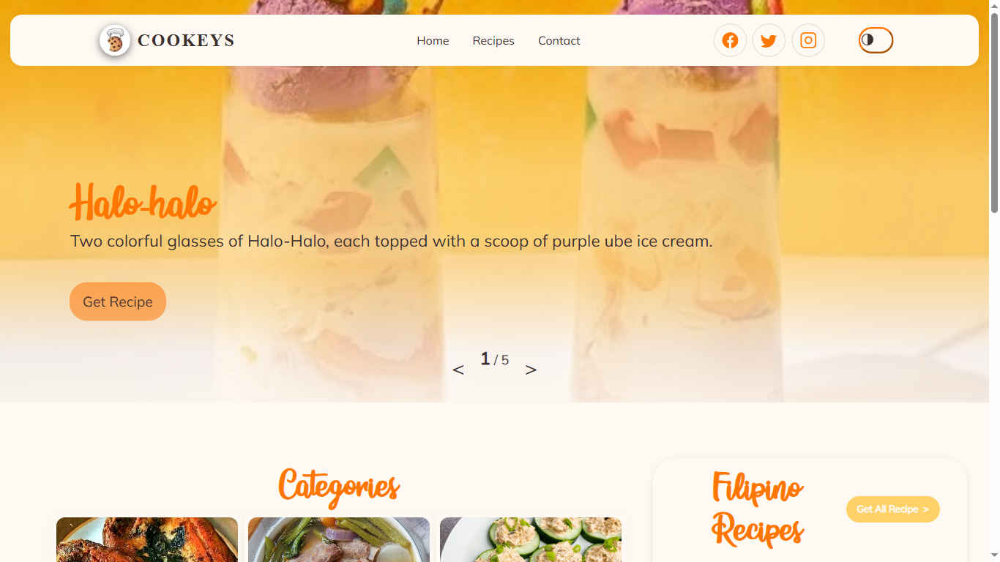

  

<h1 align="center">Hi, I'm Leander Dylan Broñola 👋</h1>

  <strong>Aspiring Software Developer · Pampanga, Philippines</strong>

  Logical thinking. Creative storytelling. Thoughtful software.

  
  
  

---

## A little about me

I'm an aspiring software developer who enjoys turning ideas into practical applications. I bring a mix of logical problem-solving and creativity to my work, from building with Java to designing responsive web experiences with HTML and CSS.

- 💻 **Building on:** Java, HTML, and CSS.
- 🌱 **Exploring:** Laravel, Bootstrap, and MySQL to connect the pieces of full-stack applications.
- 🐍 **Experimenting with:** Python for scripting, prototyping, and automating repetitive tasks.
- 🎵 **Beyond the keyboard:** Playing musical instruments, writing, and watching anime.

## Languages & tools

  
  
  
  
   
  
  
  
  
   
  
  

## Featured project

### 🍪 Cookeys

A group web project built with my teammates.

<!-- Keep pic.png in the same directory as this README to display the preview. -->

  

  <a href="https://cookeys-test-2.vercel.app/Project_Home.html"><strong>Explore Cookeys →</strong></a>

## GitHub activity

  

  

---

  <em>Thanks for stopping by. Let's keep learning and creating.</em>

  <strong>Thanks be to God.</strong>

  <a href="#top">Back to top ↑</a>

