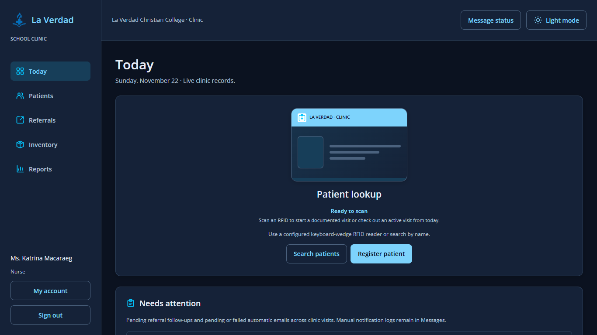
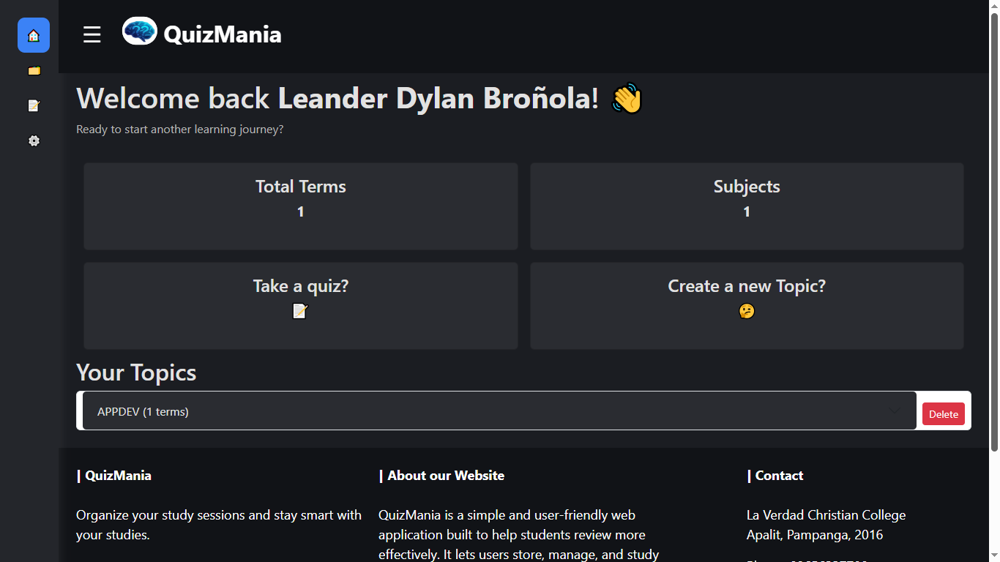
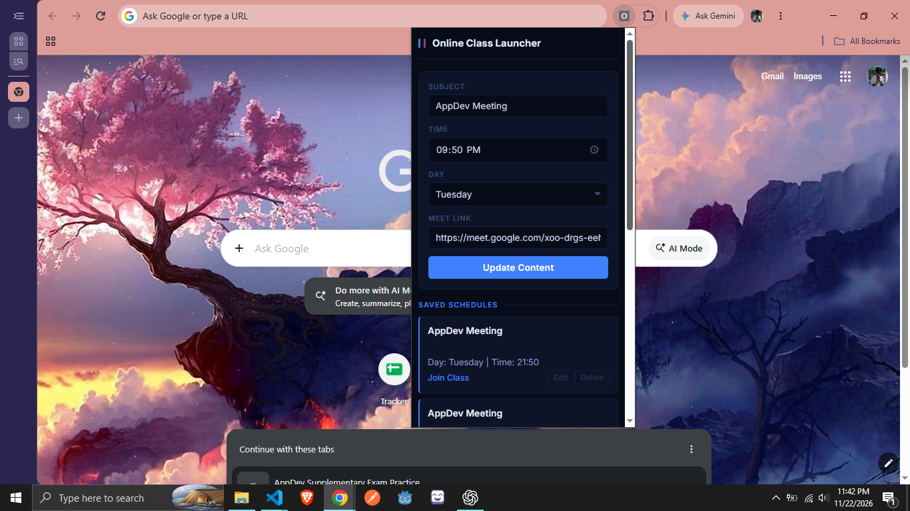
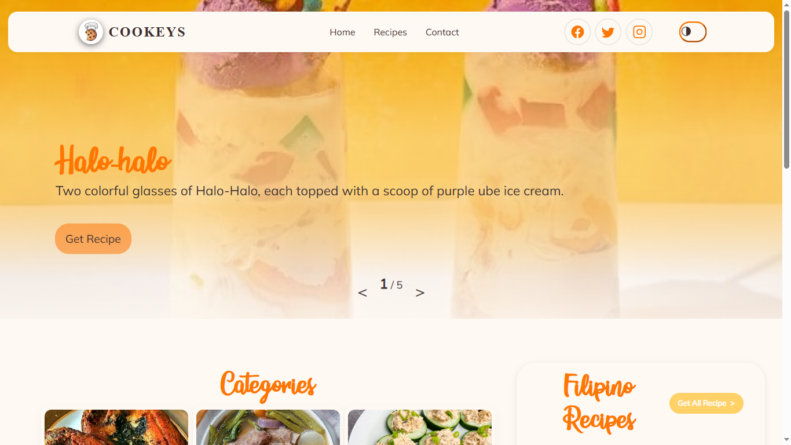
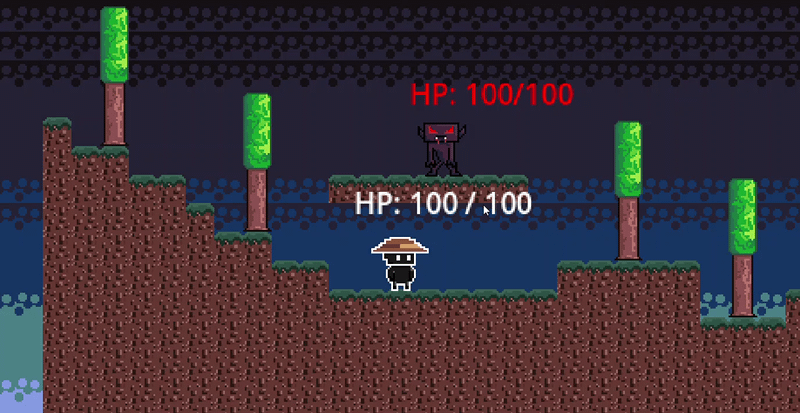

  

<h1 align="center">Hi, I'm Leander Dylan Broñola 👋</h1>

<h3 align="center">
  Student Software Engineer | Full-Stack Developer | Game Developer
</h3>

  📍 Pampanga, Philippines

  <em>Logical thinking. Creative storytelling. Thoughtful software.</em>

  
  
  

---

## 👨‍💻 About Me

I'm an **Information Systems student, Full-Stack Developer, and Game Developer** passionate about transforming ideas into practical, secure, and user-friendly applications.

I enjoy working across the software development lifecycle, from planning and database design to backend development, frontend implementation, and debugging.

- 🎓 Pursuing a **BS in Information Systems** at La Verdad Christian College.
- 💻 Building full-stack web applications with **React, JavaScript, PHP, Laravel, and SQL databases**.
- 🛠️ Interested in **backend engineering, REST APIs, authentication, application security, and database design**.
- 🎮 Developing 2D games using **Godot and GDScript**, exploring combat systems, enemy AI, and physics.
- 🐍 Working with **Python and Java** for applications, scripting, and automation.
- 🌱 Currently learning **Django, React Native, and financial forecasting systems**.
- 🤝 Open to freelance opportunities, collaboration, and meaningful software projects.
- 🎵 Outside coding, I enjoy music, writing, and anime.

> I believe great software should not only work — it should solve real problems and create meaningful experiences.

---

## 🛠️ Tech Stack

### Programming Languages

  

### Frontend Development

  

### Backend Development

  

### Databases

  

### Game Development

  

  <strong>GDScript • 2D Game Development • Enemy AI • Combat Systems</strong>

### Tools & Development Workflow

  

### Currently Learning

  

  <strong>Django • React Native • Financial Forecasting • Secure Application Architecture</strong>

---

## 🚀 Featured Projects

A selection of my academic, collaborative, and personal software development projects.

### 🏥 LVPRMS — Clinic Management System

**Full-Stack Web Application | Academic Project**

A clinic management system designed to support patient records, visit management, referrals, inventory tracking, and clinic operations.

**Key Areas:**
- Patient registration and visit management
- Referral and patient status tracking
- Medical inventory management
- Authentication and role-based authorization
- Reporting and administrative workflows
- User interface improvements and system maintenance

**Technologies:** Laravel, PHP, JavaScript, SQL

  <!-- Replace this placeholder with your actual screenshot -->
  

  <a href="#">
    <strong>🌐 Demo Soon</strong>
  </a>
  &nbsp;|&nbsp;
  <a href="#">
    <strong>🔗 Repository Soon</strong>
  </a>

> **Note:** Academic collaborative project. Showcase only screenshots approved for public sharing. Never include actual patient records or credentials.

---

### 📚 QuizMania — Interactive Quiz & Reviewer Application

**Full-Stack Web Application | Personal Project**

A web-based educational application designed to help users organize study materials and test their knowledge through interactive quizzes.

**Key Features:**
- User registration and authentication
- Topic and study material management
- Add, edit, and delete terms and definitions
- Interactive quizzes based on selected topics
- Quiz results and performance summaries
- Dark mode interface

**Technologies:** PHP, JavaScript, HTML, CSS, SQLite / MySQL

  

  <a href="#">
    <strong>🌐 Demo Soon</strong>
  </a>
  &nbsp;|&nbsp;
  <a href="https://github.com/lanWifi01/quizmania">
    <strong>🔗 View Repository</strong>
  </a>

---

### 🧩 Online Class Launcher — Chrome Extension

**Browser Extension | Automation Project**

A Chrome extension designed to simplify online class management by organizing meeting links and automating scheduled class launches.

**Key Features:**
- Online class schedule management
- Automatic launching of meeting links
- Local browser data storage
- Background scheduling and automation
- Custom user interface

**Technologies:** JavaScript, HTML, CSS, Chrome Extension APIs

  

  <a href="https://github.com/lanWifi01/online-class-launcher-extension">
    <strong>🔗 View Repository</strong>
  </a>

---

### 💰 Personal Budgeting & Financial Forecasting App

**Full-Stack Application | 🚧 In Progress**

An ongoing personal finance application project aimed at helping users manage daily finances, monitor spending, plan budgets, and make more informed financial decisions.

**Planned Features:**
- Income and expense tracking
- Budget allocation and monitoring
- Financial dashboards and visualizations
- Deterministic financial forecasting
- Savings goal planning
- Secure authentication and data management
- Future mobile application support

**Planned Technologies:**
- Backend: Django / Python
- Frontend: React
- Mobile: React Native
- Database: PostgreSQL
- Forecasting: Deterministic mathematical models

<!-- 

  

 -->

  

  <a href="#">
    <strong>🌐 Demo Soon</strong>
  </a>
  &nbsp;|&nbsp;
  <a href="https://github.com/lanWifi01/financial-budgeting-app">
    <strong>🔗 View Repository</strong>
  </a>

> Currently in development. Features listed above describe the intended scope and are not claims of completed functionality.

---

### 🍪 Cookeys — Filipino Recipe Website

**Frontend Web Development | Collaborative Project**

A responsive Filipino recipe website developed collaboratively with teammates.

My contributions focused on **JavaScript functionality and CSS styling**.

**Features:**
- Responsive website navigation
- Interactive homepage
- Recipe categories and browsing
- Dynamic recipe pages
- Dark mode
- Mobile-friendly layouts

**Technologies:** HTML, CSS, JavaScript

  

  <a href="https://cookeys-test-2.vercel.app/Project_Home.html">
    <strong>🌐 Explore Cookeys</strong>
  </a>
  &nbsp;|&nbsp;
  <a href="https://github.com/lanWifi01/cookeys-web">
    <strong>🔗 View Repository</strong>
  </a>

---

## 🎮 Game Development

I'm also exploring game development using **Godot 4 and GDScript**, focusing on building interactive 2D gameplay systems.

### Current Game Development Experience

- Player movement and physics
- Character animations and state management
- Enemy AI and line-of-sight detection
- Combat mechanics and hit detection
- Health, damage, and knockback systems
- Collision detection and kill zones
- Reusable scenes and resources

---

## 📊 GitHub Activity

  

  

---

## 🐍 Contribution Snake

  <picture>
    <source
      media="(prefers-color-scheme: dark)"
      srcset="https://raw.githubusercontent.com/lanWifi01/lanWifi01/output/github-snake-blue-dark.svg"
    />
    
  </picture>

---

## 🤝 Let's Connect

I'm interested in opportunities involving:

- Full-Stack Web Development
- Backend Development and API Integration
- Database-Driven Applications
- Frontend Development
- Browser Extensions and Automation
- Software Development and Game Development

I'm always open to learning, collaborating, and building useful software.

  
  
  

---

  <em>Thanks for stopping by. Let's keep learning, building, and creating.</em>

  <strong>Thanks be to God. 🙏</strong>

  <a href="#top">Back to top ↑</a>

